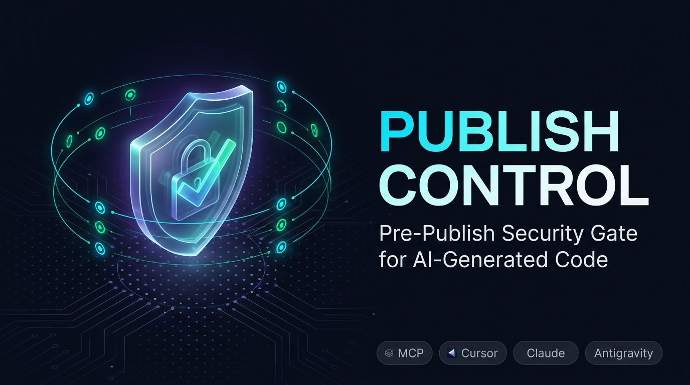

# 🛡️ Publish Control

<p align="center">
  
</p>

<p align="center">
  
  
  
  
</p>

> **Pre-publish security & code quality analysis MCP server for AI coding assistants (Google Antigravity, Cursor, Claude Desktop, Codex).**

**Publish Control**, yapay zeka kodlama asistanları ile geliştirilen projeleri yayına almadan önce **17 farklı güvenlik ve mimari kategorisinde** otomatik analizden geçiren, açık kaynaklı bir **Model Context Protocol (MCP)** sunucusudur.

---

## 🎯 17 Güvenlik & Kalite Denetim Modülü

AI asistanınıza `/publish-control` yazdığınızda sistem aşağıdaki 17 kontrolü eşzamanlı çalıştırır:

| No | Modül | İkon | Açıklama | Seviye |
|:--:|:---|:---:|:---|:---:|
| 1 | **Secrets Detection** | 🔑 | AWS, Stripe, GitHub, JWT, Google API anahtarları ve Shannon entropi analizi | `CRITICAL` |
| 2 | **Environment Security** | 📁 | `.env` dosyalarının gitignore durumu, açıkta kalan anahtarlar ve fallback riskleri | `CRITICAL` / `HIGH` |
| 3 | **Injection Protection** | 💉 | SQL string concat, NoSQL (`$where`), komut çalıştırma (`exec`), XSS kontrolleri | `CRITICAL` / `HIGH` |
| 4 | **Auth & Authorization** | 🔒 | JWT `none` algoritması, zayıf hashler (MD5/SHA1), yetkisiz Express rotaları | `CRITICAL` / `HIGH` |
| 5 | **Server Config Audit** | 🌐 | `0.0.0.0` dinleme, açık debug bayrakları, eksik Helmet koruması | `HIGH` / `MEDIUM` |
| 6 | **CORS Misconfiguration** | 🛡️ | Wildcard (`*`) origin, `credentials: true` çakışması | `HIGH` / `CRITICAL` |
| 7 | **HTTPS / TLS Security** | 🔐 | `rejectUnauthorized: false`, düz HTTP dış istekleri | `CRITICAL` / `HIGH` |
| 8 | **Path Traversal** | 📂 | `path.join`/`fs` çağrılarında kullanıcı girdisiyle dizin dışına çıkma | `CRITICAL` |
| 9 | **SSRF Detection** | 🌍 | Kullanıcı kontrollü URL istekleri, `169.254.169.254` bulut metadata sızıntısı | `CRITICAL` / `HIGH` |
| 10 | **Docker Security** | 🐳 | `USER root`, `:latest` tag, `privileged: true`, `.dockerignore` denetimi | `HIGH` / `MEDIUM` |
| 11 | **Dependency Audit** | 📦 | Eksik lockfile (`package-lock.json`), wildcard (`*`) versiyonlar, riskli paketler | `HIGH` / `MEDIUM` |
| 12 | **Rate Limiting** | ⚡ | Brute-force ve DoS risklerine karşı rate limiter koruma eksikliği | `MEDIUM` / `HIGH` |
| 13 | **File Permissions** | 🗂️ | `chmod 777` kullanımı, filtresiz dosya yükleme (multer) | `HIGH` / `MEDIUM` |
| 14 | **Error Handling** | ❌ | Stack trace sızıntısı, istemciye çiğ hata objesi dönülmesi | `MEDIUM` |
| 15 | **Sensitive Logging** | 📝 | `console.log` ile şifre, token ve request body yazdırılması | `MEDIUM` / `HIGH` |
| 16 | **Security Config** | 🔧 | Eksik `httpOnly` çerez bayrakları, TypeScript strict mod eksikliği | `MEDIUM` / `HIGH` |
| 17 | **Code Quality Hygiene** | 📊 | `@ts-ignore` aşırılığı, çözülmemiş güvenlik TODO/FIXME notları, `any` kirliliği | `LOW` / `MEDIUM` |

---

## 🛠️ Sunulan MCP Araçları (Tools)

- **`publish_control`**: 17 kategoride tam tarama yapar, 0-100 güvenlik skoru ve görsel Markdown raporu üretir.
- **`publish_control_quick`**: Sadece en kritik güvenlik açıklarını (Secrets, Env, Injection, Auth, Server) hızla inceler.
- **`publish_control_fix`**: Tespit edilen herhangi bir bulgunun ID'sine (ör. `SEC-001`, `INJ-002`) göre kod düzeltme ve refactor önerisi verir.

---

## 🚀 Hızlı Başlangıç

### 1. Kurulum & Derleme

```bash
git clone https://github.com/EthYusuf/publish-control.git
cd publish-control
npm install
npm run build
```

### 2. İstemcinize MCP Konfigürasyonunu Ekleyin

#### **Google Antigravity**
`~/.gemini/config/mcp_config.json`:
```json
{
  "mcpServers": {
    "publish-control": {
      "command": "node",
      "args": ["<PATH_TO_PUBLISH_CONTROL>/dist/index.js"]
    }
  }
}
```

#### **Cursor IDE**
`~/.cursor/mcp.json` veya `.cursor/mcp.json`:
```json
{
  "mcpServers": {
    "publish-control": {
      "command": "node",
      "args": ["<PATH_TO_PUBLISH_CONTROL>/dist/index.js"]
    }
  }
}
```

#### **Claude Desktop**
`%APPDATA%\Claude\claude_desktop_config.json`:
```json
{
  "mcpServers": {
    "publish-control": {
      "command": "node",
      "args": ["<PATH_TO_PUBLISH_CONTROL>\\dist\\index.js"]
    }
  }
}
```

---

## 🧪 Testleri Çalıştırma

```bash
npm test
```

---

## 📄 Lisans

Bu proje [MIT Lisansı](LICENSE) altında lisanslanmıştır.
